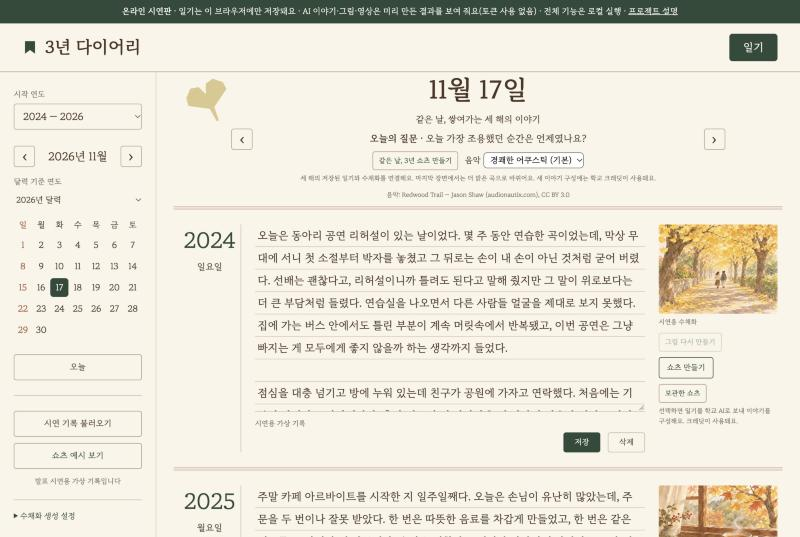
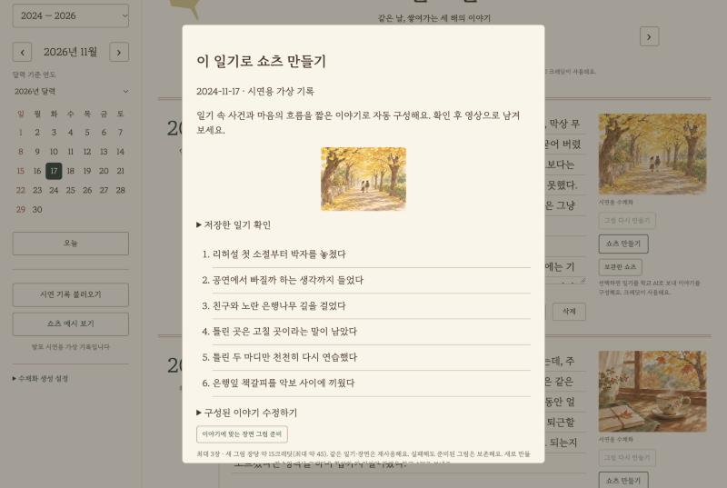
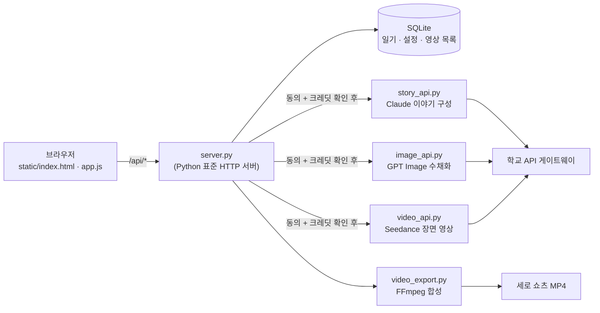
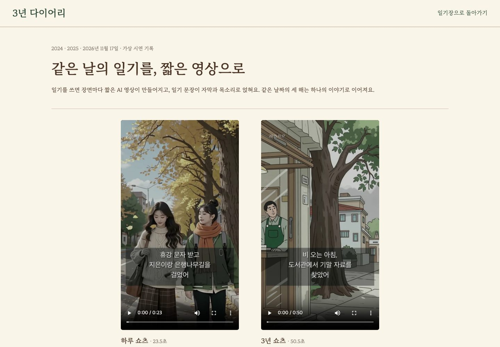

# 3년 다이어리 — 같은 날, 세 해의 이야기

> 같은 날짜의 일기를 3년 동안 한 화면에 쌓고, AI가 그 일기를 **짧은 이야기·수채화·장면마다 움직이는 세로 쇼츠 영상**으로 만들어 주는 웹 앱입니다.

**[▶ 온라인 시연판 열기](https://kiwisoop.github.io/same-day-diary/)** · **[쇼츠 예시 페이지](https://kiwisoop.github.io/same-day-diary/site/shorts.html)** · 인공지능활용실습 기말 프로젝트



## 이런 결과물을 만듭니다

<table>
  <tr>
    <th>하루 쇼츠 (23.5초)</th>
    <th>3년 쇼츠 · 세 해를 잇는 장면 (50.5초 중)</th>
    <th>3년 쇼츠 마무리</th>
  </tr>
  <tr>
    <td></td>
    <td></td>
    <td></td>
  </tr>
</table>

소리가 있는 원본 영상: [하루 쇼츠 MP4](previews/example-day.mp4) · [3년 쇼츠 MP4](previews/example-three-year.mp4) · 브라우저에서 바로 보기: [쇼츠 예시 페이지](https://kiwisoop.github.io/same-day-diary/site/shorts.html)

장면 영상은 Seedance(학교 API)로 만들고, 일기마다 정한 **같은 인물 설명**을 모든 장면에 넣어 세 해 내내 주인공과 친구가 같은 모습으로 나옵니다. 자막과 목소리는 이 컴퓨터에서 얹습니다.

## 3단계로 보는 사용 흐름

| ① 쓰기 | ② AI가 구성 | ③ 영상으로 남기기 |
|---|---|---|
| 같은 월·일에 세 해의 일기를 나란히 씁니다. 날마다 **오늘의 질문**과 응원 문구가 있고, 저장하면 그날의 **수채화**가 일기 배경에 은은하게 깔립니다. | AI가 일기를 읽고 **사건을 장면 문장 몇 개**로 정리합니다. 문장은 쇼츠 창에서 눌러 바로 고칠 수 있습니다. | 원하면 장면마다 **AI 영상(Seedance)**을 만들고, 자막·배경음악·**자막을 읽어 주는 AI 목소리**를 더해 **720×1280 세로 쇼츠**를 만듭니다. 같은 날의 세 해는 **3년 쇼츠** 한 편으로 잇고, 완성 영상은 보관됩니다. |



## 확인 포인트

- **주제:** 일기 앱에 "같은 날 3년 비교"와 "일기 → 숏폼 영상"을 결합했습니다. 감정 점수를 매기지 않고 기록 자체를 이야기로 돌려줍니다.
- **AI 활용:** 이야기 구성은 Claude(`claude-sonnet-4-6`), 수채화는 GPT Image(`gpt-image-2.5-sunburst`), 장면 영상은 Seedance(`bytedance/seedance-1-pro`)를 학교 API로 호출합니다. 호출 전에 동의와 예상 크레딧을 확인하고, 같은 일기·같은 장면은 결과를 다시 써서 중복 비용을 막습니다.
- **구현:** Python 표준 라이브러리 서버, SQLite, 순수 HTML/CSS/JS, FFmpeg 영상 합성으로 만들었습니다. 외부 프레임워크는 쓰지 않았습니다.
- **검증:** 자동 테스트 Python 85개와 Node 프런트엔드 검사가 모두 통과했습니다(임시 DB와 모의 응답 사용). 실제 MP4 출력도 확인했습니다.
- **개발 과정:** Codex가 요구사항 정리·설계·검토를, Claude Code가 구현·테스트를 맡았습니다. 아래 [AI 활용 과정](#ai-활용-과정)에 정리했습니다.

---

# 자세한 설명

## 목차

1. [온라인 시연판과 로컬 실행의 차이](#온라인-시연판과-로컬-실행의-차이)
2. [로컬 실행 방법](#로컬-실행-방법)
3. [주요 기능](#주요-기능)
4. [구조](#구조)
5. [AI 활용 과정](#ai-활용-과정)
6. [AI 비용(토큰) 관리](#ai-비용토큰-관리)
7. [개인정보와 보안](#개인정보와-보안)
8. [테스트와 검증](#테스트와-검증)
9. [폴더 구성](#폴더-구성)
10. [출처와 라이선스](#출처와-라이선스)
11. [한계와 향후 과제](#한계와-향후-과제)

## 온라인 시연판과 로컬 실행의 차이

GitHub Pages는 정적 파일(HTML·CSS·JS·이미지·영상)만 제공합니다. Python 서버, FFmpeg, 학교 AI API는 실행할 수 없습니다. 그래서 온라인 시연판은 **같은 화면과 같은 `app.js`를 쓰고, 서버 API만 브라우저 안에서 흉내 냅니다**([`site/mock-api.js`](site/mock-api.js)).

| 기능 | 온라인 시연판 (github.io) | 로컬 실행 |
|---|---|---|
| 일기 쓰기·수정·삭제, 3년 비교, 오늘의 질문, 임시 글 복구 | ✅ 이 브라우저(localStorage)에만 저장 | ✅ SQLite에 저장 |
| 시연 기록 불러오기 (가상 일기 3편) | ✅ | ✅ |
| AI 이야기 구성 | 시연 기록만 미리 작성한 장면 문장 사용 | ✅ 학교 AI 호출 |
| AI 수채화 | 시연 그림만 표시 | ✅ 학교 AI 호출 (저장할 때 자동) |
| AI 장면 영상 (Seedance) | 예시 쇼츠에 들어 있는 영상만 재생 | ✅ 학교 AI 호출 (선택, 장면마다 확인) |
| 하루·3년 쇼츠 만들기 | 시연 기록만 미리 만든 영상 재생 | ✅ FFmpeg으로 새로 합성 |
| 자막 읽어 주기(AI 음성) | 미리 만든 예시 영상의 목소리만 재생 | ✅ 음성 모델 설치 시 이 컴퓨터에서 생성(크레딧 없음) |
| 학교 AI 토큰 사용 | **없음** | 동의·확인 후 사용 |

시연판 파일은 `static/` 원본에서 자동으로 만듭니다.

```sh
python3 tools/build_site.py   # static/ → site/ (경로 변환 + mock-api.js 연결)
```

## 로컬 실행 방법

준비물은 Python 3.10 이상과 FFmpeg입니다. 외부 Python 패키지는 필요 없습니다.

```sh
git clone https://github.com/kiwisoop/same-day-diary.git
cd same-day-diary
cp .env.example .env       # 학교 API 키를 편집기에서 직접 입력 (선택)
python3 server.py
```

브라우저에서 http://127.0.0.1:8766 을 엽니다.

- **API 키 없이도** 일기 쓰기, 시연 기록, 시연 쇼츠는 모두 동작합니다. 키는 새 일기로 AI 이야기·그림을 만들 때만 필요합니다.
- 키를 찾는 순서는 `FACTCHAT_API_KEY` 환경변수 → 저장소의 `.env` → 상위 폴더 `.env`입니다. 다른 학교 게이트웨이를 쓰면 `FACTCHAT_API_ROOT`(https 주소)로 영상 API 주소를 바꿀 수 있습니다.
- FFmpeg를 찾는 순서는 `FFMPEG` 환경변수 → `ffmpeg-full` → PATH이고, 자막(drawtext)을 그릴 수 있는 빌드를 우선합니다. macOS에서는 `brew install ffmpeg-full`을 권장합니다.
- 한글 글꼴을 찾는 순서는 `DIARY_FONT` → macOS 기본 → 나눔 → Noto CJK → 맑은 고딕입니다.
- **내레이션(선택):** 자막을 목소리로 읽으려면 앱과 별도의 파이썬 환경에 음성 모델을 설치합니다(모델 약 385MB를 Hugging Face에서 받음). 설치하지 않으면 내레이션 선택지가 보이지 않고 나머지는 그대로 동작합니다.

  ```sh
  python3 -m venv .tts/venv
  .tts/venv/bin/pip install supertonic==1.3.1
  .tts/venv/bin/python -c "from supertonic import TTS; TTS(model_dir='.tts/models')"
  ```
- 데이터는 `data/`(SQLite·생성 이미지·장면 영상·완성 영상)에 저장되고 Git에는 올라가지 않습니다.

## 주요 기능

| 영역 | 기능 |
|---|---|
| 일기 | 같은 월·일 3년 세로 비교, 시작 연도 설정, 윤일(2/29)·미래 날짜 검증, 1~10,000자 |
| 쓰기 도우미 | 날짜별 **오늘의 질문**(매년 같은 질문)과 응원 문구(쓰기 권유·칭찬·명언), 지난 해 기록이 있으면 "지난 기록 먼저 읽기" 안내 |
| 안전한 작성 | 브라우저 임시 저장, 새로고침 후 복구, 저장본과 다른 임시 글은 사용자가 고를 때까지 보존 |
| AI 이야기 | 일기 → 1~8개 장면 문장(친구에게 들려주듯 자연스러운 반말, 장면당 64자 이하), 문장을 눌러 바로 수정, 수정본은 다음 쇼츠에서 재사용 |
| AI 그림 | 저장하면 일기 → 수채화 1장을 자동으로 만들어 일기 배경에 25% 투명도로 표시, 내용이 같으면 재사용 |
| AI 장면 영상 | 장면 문장마다 5초 영상(Seedance, 720p 세로). 일기마다 정한 인물 설명(성별·나이·머리·옷)을 모든 장면에 넣어 인물이 바뀌지 않음. 진행 중 작업은 이어서 확인해 두 번 결제하지 않음 |
| 쇼츠 | 720×1280 세로 영상, 장면마다 AI 영상(없으면 수채화), 자막과 똑같은 문장을 읽는 목소리, 배경음악과 출처 표기 |
| 내레이션 | 장면 자막을 오픈소스 AI 음성(Supertonic 3, F1 목소리)으로 읽어 줌. 장면 길이를 읽는 시간에 맞추고 목소리가 나올 때 음악을 자동으로 줄임. 이 컴퓨터에서 생성해 크레딧이 들지 않으며 켜고 끌 수 있음 |
| 3년 쇼츠 | 제목 카드("2024 → 2026"), "1년 후·2년 후" 연도 카드, 세 해의 수채화가 모이는 마무리 장면, 마무리에서 밝은 곡으로 전환 |
| 보관함 | 완성 영상 보관·재생·MP4 저장, 일기가 바뀌면 "수정 전 일기로 만든 영상" 표시 |

감정 점수·수치·배지는 의도적으로 넣지 않았습니다. 기록을 평가하지 않고 이야기로 돌려주는 것이 목표입니다.

## 구조



| 파일 | 역할 |
|---|---|
| `server.py` | 라우팅, Host/Origin 검사, 일기·이미지·이야기·영상 API, 결과 캐시 |
| `storage.py` | SQLite 저장, 날짜 검증, 시연 기록 적재 |
| `story_api.py` | 일기 → 장면 문장 (형식 검사, 긴 문장 줄이기) |
| `image_api.py` | 수채화 생성 |
| `video_api.py` | 장면 영상(Seedance) 제출·상태 확인·다운로드. 같은 인물 설명을 프롬프트에 넣음 |
| `video_export.py` | 카드·자막·그림 장면 렌더링, 음악 크로스페이드·음량 맞춤, 내레이션 믹스(음악 자동 줄이기), 출처 메타데이터 |
| `narration.py` · `tts_worker.py` | 장면 문장을 로컬 TTS(Supertonic 3 F1)로 읽어 WAV로 캐시. TTS는 별도 파이썬 환경(`.tts/`)에서 실행 |
| `static/` | 화면(HTML/CSS/JS) |
| `site/` | GitHub Pages 시연판 (`tools/build_site.py`로 생성) |

주요 API는 `GET/POST/DELETE /api/diary`, `POST /api/image`, `POST /api/shorts/story`, `POST /api/shorts/clip`, `POST /api/shorts`, `POST /api/three-year-video`, `GET /api/videos`, `GET/POST /api/settings`, `POST /api/demo`입니다.

**캐시:** 이야기·그림·장면 영상은 일기 본문의 SHA-256 해시로 저장합니다. 같은 일기·같은 장면·같은 인물 설명이면 AI를 다시 부르지 않습니다.

## AI 활용 과정

| 단계 | 담당 | 내용 |
|---|---|---|
| 기획·요구사항 | 사용자 + Codex | 주제 선정, 기능 범위, 감정 수치화 폐기 결정 |
| 설계·검토 | Codex | 구현 계획 작성, 결과 검토, 수정 요청, 협업 기록 관리 |
| 구현·검증 | Claude Code | 코드 작성, 테스트 작성·실행, 오류 수정. ECC 플러그인의 기능 개발 흐름과 코드 리뷰 에이전트 사용 |
| 앱 안의 AI | 학교 API | 이야기 구성 `claude-sonnet-4-6`, 수채화 `gpt-image-2.5-sunburst`(그림 1장 약 15크레딧), 장면 영상 `bytedance/seedance-1-pro`(5초 1개 약 60크레딧, 계정마다 다를 수 있음) |

만든 순서:

1. **일기와 AI 이야기:** 같은 날 3년 비교 일기, 오늘의 질문·응원 문구, 임시 글 복구, 일기 → 장면 문장 구성을 만들었습니다.
2. **그림:** 저장하면 수채화를 자동으로 만들어 일기 배경에 깔고, 같은 내용이면 다시 만들지 않게 했습니다.
3. **쇼츠:** 장면마다 Seedance 영상을 만들고 자막·배경음악·내레이션(오픈소스 TTS)을 얹어 하루 쇼츠와 3년 쇼츠(제목·연도 카드, 마무리 장면)를 합성합니다. 장면마다 인물이 바뀌던 문제는 일기마다 인물 설명을 고정해 해결했습니다.
4. **정리:** 쇼츠 창을 문장 목록·선택 두 개·버튼 두 개로 줄이고, 버튼 크기를 맞추고, 시연 일기를 짧은 평범한 하루 3편으로 다시 썼습니다.
5. **공개:** GitHub Pages 정적 시연판과 쇼츠 예시 페이지를 만들었습니다.

쇼츠 예시 페이지(영상 두 편과 바탕이 된 일기):



## AI 비용(토큰) 관리

- **온라인 시연판은 AI를 한 번도 호출하지 않습니다.** 미리 만든 이야기·그림·영상만 보여 주므로, 누가 몇 번을 열어도 토큰이 들지 않습니다.
- **API 키는 로컬 `.env`에만 둡니다.** 브라우저 코드나 저장소에는 키가 없습니다. 정적 사이트에 키를 넣으면 누구나 볼 수 있기 때문입니다.
- **로컬 실행:** 그림·영상을 만들기 전에 동의와 "약 N크레딧" 확인 창을 거치고, 같은 일기는 결과를 다시 씁니다. AI 영상은 쇼츠 창에서 체크했을 때만 만들고, 이미 만든 장면은 빼고 안내합니다. 실패한 영상 작업은 학교 API에서 환불되고, 진행 중인 작업은 다시 제출하지 않습니다.
- **다른 사람이 실행할 때:** 각자 자기 키를 `.env`에 넣고 로컬에서 실행합니다. 키가 없어도 시연 기능은 동작합니다.

## 개인정보와 보안

- 일기 DB·생성 이미지·영상(`data/`)과 `.env`는 `.gitignore`로 제외했습니다. 저장소의 일기는 모두 **가상 시연 기록**입니다.
- 서버는 `127.0.0.1`에서만 열리고, Host·Origin 헤더를 검사해 다른 사이트의 요청을 막습니다.
- 일기 본문은 사용자가 동의한 경우에만 학교 API로 보냅니다.
- 온라인 시연판에 쓴 일기는 그 브라우저에만 남습니다. 서버로 보내지 않고, 브라우저 데이터를 지우면 사라집니다.

## 테스트와 검증

```sh
python3 -m unittest -q      # 85개: 저장·검증·캐시·비용 확인·장면 영상·인물 통일·영상 길이·음악·내레이션·실제 MP4
node test_frontend.cjs      # 임시 글 복구·충돌, 오늘의 질문·응원 문구, 일기 배경 그림, 쇼츠 창 문장 수정·AI 영상 선택 등
```

- 테스트는 임시 DB와 모의 AI 응답을 씁니다. 실제 기록과 유료 API를 건드리지 않습니다.
- 상세 결과는 [TEST_REPORT.md](TEST_REPORT.md)에 있습니다.
- 온라인 시연판은 로컬 정적 서버에서 직접 확인했습니다. 시연 기록 불러오기 → 하루 쇼츠 → 3년 쇼츠 → 보관함 순서로 동작했고, 콘솔 오류는 없었습니다.

## 폴더 구성

```
same-day-diary/
├─ index.html            # Pages 진입점 → site/ 로 이동
├─ server.py · storage.py · story_api.py · image_api.py · video_api.py · video_export.py · narration.py
├─ static/               # 앱 화면 원본
├─ site/                 # GitHub Pages 시연판 (자동 생성 + mock-api.js)
├─ tools/build_site.py   # 시연판 생성 스크립트
├─ assets/               # 글꼴, 시연 수채화, 배경음악, 출처 문서
├─ previews/             # 예시 쇼츠 MP4·포스터
├─ docs/images/          # README 캡처·GIF
├─ demo_diaries.json     # 가상 시연 일기 3편 + 미리 쓴 장면 문장
├─ test_*.py · test_frontend.cjs
└─ TEST_REPORT.md
```

## 출처와 라이선스

- **글꼴:** NAVER 마루 부리(MaruBuri). 출처와 라이선스는 [assets/FONT_LICENSE.txt](assets/FONT_LICENSE.txt)에 있습니다.
- **배경음악:** Wikimedia Commons의 CC BY·퍼블릭 도메인 곡 5곡을 씁니다. 작곡가와 라이선스는 [assets/AUDIO_SOURCE.md](assets/AUDIO_SOURCE.md)에 있습니다. 앱 화면·보관함·MP4 메타데이터에도 출처를 표시합니다. 영상을 외부에 올릴 때는 설명란에도 출처를 적어야 합니다.
- **내레이션 음성:** Supertone의 오픈 웨이트 모델 Supertonic 3(F1 목소리, BigScience OpenRAIL-M)을 씁니다. AI 생성 음성임을 밝혀야 하므로 보관함·예시 페이지·MP4 메타데이터에 "AI-generated voice"를 표시합니다. 모델 파일은 저장소에 넣지 않았습니다.
- **시연 수채화·장면 영상:** 학교 이미지 API와 영상 API(Seedance)로 생성했습니다. 시연 일기는 모두 가상으로 작성했습니다.

## 한계와 향후 과제

- 온라인 시연판에서는 새 일기로 AI 이야기·그림·영상을 만들 수 없습니다. 서버와 API 키가 필요해서 로컬 실행에서만 됩니다.
- AI 장면 영상은 수채화보다 애니메이션에 가까운 그림체로 나오고, 가끔 옆으로 누운 듯한 어색한 구도가 나옵니다. 장면당 크레딧이 들어 다시 만들기도 신중해야 합니다.
- 시연판의 일기는 브라우저에만 저장되므로 다른 기기와 공유되지 않습니다.
- 배경음악은 곡 설명을 보고 골랐습니다. 실제 분위기는 들어 보고 조정할 예정입니다.
- 폭 720px 이하 화면에서는 달력이 숨겨지고, 날짜는 앞뒤 버튼으로만 이동합니다.
- 내레이션은 로컬에 음성 모델을 설치했을 때만 켤 수 있고, 온라인 시연판에서는 미리 만든 예시 영상의 목소리만 들을 수 있습니다.
- 향후 과제: 모바일 달력 개선, 일기 삭제 시 그 일기로 만든 음성·그림 파일 함께 정리.
